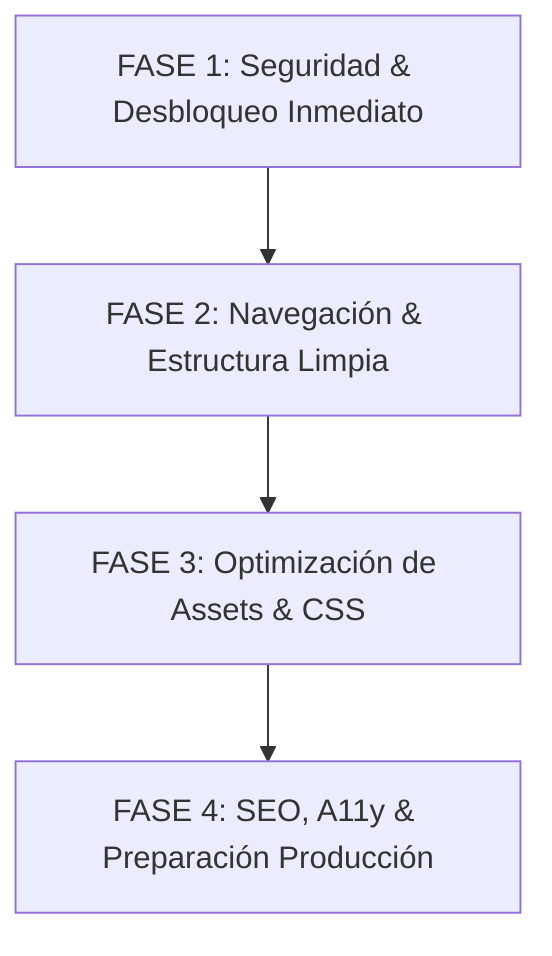

# 📋 INFORME DE AUDITORÍA TÉCNICA Y DIAGNÓSTICO SENIOR
## PROYECTO: ESVOJOP 2026 — Club de Voleibol Formativo de Alto Nivel
**Rol:** Desarrollador Senior / Tech Lead  
**Fecha de Auditoría:** Noviembre 2026  
**Entorno Analizado:** HTML5 / CSS3 / Vanilla JavaScript (Arquitectura Frontend Estática)  
**Estado General:** Prototipo funcional en fase de desarrollo con deuda técnica crítica de seguridad, lógica rota en formularios y arquitectura desacoplada no apta para producción.

---

## 1. RESUMEN EJECUTIVO

Como desarrollador Senior que asume la responsabilidad técnica de este proyecto, se ha realizado un barrido exhaustivo del 100% de los archivos del repositorio (`voleibol/`, archivos en la raíz y subcarpetas).

El sitio web de **ESVOJOP** posee una base visual moderna, atractiva y una temática bien definida (deportes, azul/dorado, tipografías con carácter como *Bebas Neue* y *Manrope*). Sin embargo, bajo el capó existen **fallas críticas de seguridad, políticas CSP mal configuradas que rompen el envío de formularios, una arquitectura de administración simulada en cliente con credenciales expuestas en texto plano, páginas huérfanas sin enlace alguno y problemas severos de optimización de assets**.

Para que este proyecto pueda pasar a un entorno de **producción real**, requiere una intervención estructurada por etapas sin romper su identidad visual.

---

## 2. INVENTARIO COMPLETO Y ARQUITECTURA ACTUAL

### 2.1. Estructura de Archivos
```text
ESVOJOP2026/
├── text.js/
│   └── text                              <-- ⚠️ ARCHIVO BASURA: fragmento huérfano de fetch
├── agents/                               <-- ⚠️ RESIDUO EXTERNO: Proyecto ajeno ("El Bodegón de los Trajes")
└── voleibol/                             <-- PROYECTO REAL ESVOJOP
    ├── index.html                        (231 líneas - Landing principal)
    ├── sobre-nosotros.html               (159 líneas - Historia, valores, filosofía)
    ├── galeria.html                      (104 líneas - Grilla de fotos + Lightbox)
    ├── contenido-extra.html              (123 líneas - Indumentaria + Comunidad)
    ├── contacto.html                     (225 líneas - Formulario + Datos IRDET)
    ├── guia.html                         (170 líneas - ⚠️ HUÉRFANA: Guía de equipamiento)
    ├── tienda.html                       (198 líneas - ⚠️ HUÉRFANA: Tienda ficticia)
    ├── .gitignore                        (Configuración básica)
    ├── css/
    │   └── style.css                     (1.924 líneas - Monolito CSS con duplicidad)
    ├── js/
    │   ├── main.js                       (166 líneas - UI global, menú, lightbox)
    │   └── modules/
    │       ├── contacto.js               (38 líneas - Lógica AJAX FormSubmit)
    │       └── add-content.js            (827 líneas - ⚠️ Admin simulado / XSS / LocalStorage)
    └── img/
        ├── balon.svg, rodillera.svg, uniforme.svg
        ├── fotos/logo/
        │   └── Captura de pantalla 2026-04-20 130524.png  <-- Nombre sin optimizar
        └── fotos/imagines/               <-- ⚠️ Carpeta con errata ortográfica ("imagines")
            └── [11 fotos WhatsApp .jpeg con espacios y duplicados]
```

---

## 3. CLASIFICACIÓN DE HALLAZGOS Y FALLAS

```
┌───────────────────────────────────────────────────────────────┐
│                    MATRIZ DE SEVERIDAD                        │
├─────────────────┬─────────────────────────────────────────────┤
│ 🔴 CRÍTICAS     │ 5 Hallazgos (Bloqueantes / Seguridad / CSP) │
│ 🟡 MODERADAS    │ 7 Hallazgos (UX, Lógica rota, Discrepancias)│
│ 🔵 PUNTOS MEJORA│ 6 Hallazgos (A11y, SEO, Semántica)          │
│ 🟢 OPTIMIZACIÓN │ 5 Hallazgos (Performance, CSS, Limpieza)    │
└─────────────────┴─────────────────────────────────────────────┘
```

---

### 🔴 3.1. FALLAS CRÍTICAS (Severidad Alta)

#### 1. Violación de Content Security Policy (CSP) que bloquea el Formulario AJAX
- **Ubicación:** Todos los archivos HTML (`line 11`) y `voleibol/js/modules/contacto.js` (`line 18`).
- **Problema:** En el `<head>` de todas las páginas se define:
  ```html
  <meta http-equiv="Content-Security-Policy" content="default-src 'self'; script-src 'self' 'unsafe-inline'; style-src 'self' 'unsafe-inline' https://fonts.googleapis.com; font-src 'self' https://fonts.gstatic.com; img-src 'self' data:; frame-ancestors 'none'; form-action 'self' https://formsubmit.co">
  ```
  La directiva `connect-src` **no está definida**. Por especificación W3C, hereda de `default-src 'self'`.
  Cuando `contacto.js` ejecuta:
  ```javascript
  fetch('https://formsubmit.co/ajax/avimateo2@gmail.com', ...)
  ```
  El navegador **bloquea inmediatamente la petición fetch** por violación de CSP.
- **Consecuencia:** La promesa falla siempre, cae al bloque `catch` y ejecuta `this.target = '_blank'; HTMLFormElement.prototype.submit.call(this);`, abriendo una pestaña en blanco hacia FormSubmit y rompiendo la experiencia interactiva que se intentó programar.

#### 2. Credenciales Administrativas Expuestas en Código Cliente y "Admin Mode" Ficticio
- **Ubicación:** `voleibol/js/modules/add-content.js` (`lines 9-10`).
- **Problema:**
  ```javascript
  const ADMIN_USER = 'esvojop';
  const ADMIN_PASS = 'esvojop2026';
  ```
  Cualquier visitante puede inspeccionar el archivo JS o simplemente escribir en la consola de Chrome `sessionStorage.setItem('esvojop_admin', 'true')` para activar el modo de edición.
- **Vulnerabilidad y Falacia Arquitectónica:**
  - El sistema permite "crear", "editar" y "eliminar" tarjetas en `index.html`, `sobre-nosotros.html`, etc.
  - **Pero ninguna de estas ediciones persiste**: solo modifican el DOM en la memoria de la sesión local. Al recargar la página (`F5`), todos los cambios desaparecen.
  - Engaña al cliente o usuario haciéndole creer que el sitio cuenta con un CMS funcional cuando en realidad es un mock efímero.

#### 3. Vulnerabilidad de Inyección de Código (Stored / DOM XSS)
- **Ubicación:** `voleibol/js/modules/add-content.js` (`lines 360-390, 465-468, 580-625, 695-700`).
- **Problema:** Los datos ingresados en los formularios modales (título, descripción, iconos) se concatenan directamente en cadenas HTML y se asignan mediante `card.innerHTML = newInner`.
- **Riesgo:** Si un usuario con rol de administrador (o atacante mediante manipulación de inputs) ingresa un payload como ``, el script se ejecuta en el navegador. En la galería, estos datos se guardan en `localStorage` y se re-ejecutan en cada carga.

#### 4. Riesgo de Colapso de Almacenamiento Local (`QuotaExceededError`)
- **Ubicación:** `voleibol/js/modules/add-content.js` (`lines 653-672`).
- **Problema:** La función de subida de fotos lee el archivo mediante `reader.readAsDataURL(imgFile)` e inserta el string Base64 resultante directamente en `localStorage.setItem('esvojop_gallery', ...)`.
- **Consecuencia:** El límite estándar de `localStorage` en navegadores móviles y de escritorio es de **5 MB compartidos para todo el dominio**. Una sola fotografía tomada con un celular moderno pesa entre 4 MB y 12 MB (en Base64 aumenta un 33%). El navegador lanzará una excepción no controlada `DOMException: QuotaExceededError`, quebrando la ejecución del script.

#### 5. Páginas Huérfanas y Desconexión de Rutas (`tienda.html` y `guia.html`)
- **Ubicación:** Barra de navegación (`<nav class="nav-links">`) en todos los archivos HTML.
- **Problema:** El menú solo incluye: *Inicio, Sobre Nosotros, Galería, Contenido Extra, Contacto*.
- **Consecuencia:** Ni `tienda.html` ni `guia.html` están enlazadas en ninguna parte del sitio. Son páginas fantasmas que los motores de búsqueda no rastrean con facilidad y a las que ningún usuario común puede llegar navegando.

---

### 🟡 3.2. FALLAS MODERADAS (Severidad Media)

#### 1. Inconsistencia Estructural del Header (`club-header`) en `contenido-extra.html`
- **Ubicación:** `voleibol/contenido-extra.html` (`lines 18-21`).
- **Problema:** En `contenido-extra.html`, el bloque `.club-header` (logo y nombre del club) está insertado **antes de la etiqueta `<nav>`**:
  ```html
  <div class="club-header reveal">...</div>
  <nav>...</nav>
  ```
  Mientras que en `index.html` está dentro de `<section class="hero">`, y en las demás páginas (`sobre-nosotros.html`, `galeria.html`, `contacto.html`) **no existe**.
- **Impacto Visual:** Dado que `<nav>` tiene `position: fixed; top: 0`, en desktop y mobile este encabezado queda cubierto o desfasado respecto al flujo del documento.

#### 2. Lógica Rota en el Lightbox Compartido (`main.js`)
- **Ubicación:** `voleibol/js/main.js` (`lines 108-165`).
- **Problema:**
  - El lightbox escucha las teclas de flecha `ArrowLeft` y `ArrowRight` llamando a `changeImage(dir)`.
  - La función `changeImage` depende exclusivamente de encontrar elementos `.gallery-item img`.
  - En `contenido-extra.html`, el lightbox se activa para `.extra-card[data-img]`. Al abrir una foto en esta página y presionar las flechas del teclado, `changeImage` busca `.gallery-item`, no encuentra nada y falla silenciosamente. Además, `contenido-extra.html` carece de los botones `#lbPrev` y `#lbNext`.

#### 3. Estilos en Línea Extremos y Colores Discordantes
- **Ubicación:** `voleibol/sobre-nosotros.html` (`line 38`).
- **Problema:**
  ```html
  <p class="page-desc reveal" style="... color:#ff3333; -webkit-text-fill-color:#ff3333; background:none; font-size:1.3rem;">Formación deportiva de alto nivel · Disciplina, respeto y compromiso.</p>
  ```
  Se aplicó un color rojo brillante agresivo (`#ff3333`) que parece un mensaje de error o alerta, rompiendo por completo la paleta institucional azul eléctrico (`#0055ff`) y amarillo/oro (`#ffd700`).

#### 4. Enlaces Vacíos y "Botones Muertos" (Dead Anchors)
- **Ubicación:** `contacto.html` (`line 180`), `contenido-extra.html` (`lines 89-91`), `index.html` (`lines 222-224`).
- **Problema:** Múltiples botones y enlaces tienen `href="#"`. Por ejemplo, el botón *"Quiero inscribirme"* en la caja de precios de `contacto.html` no hace nada ni desplaza la página hacia el formulario de inscripción situado unos píxeles más arriba (`href="#formulario"`).

#### 5. Grilla Desbalanceada en Evaluaciones (`sobre-nosotros.html`)
- **Ubicación:** `voleibol/sobre-nosotros.html` (`lines 121-127`).
- **Problema:** El contenedor `<div class="grid-3 reveal">` está diseñado en CSS como un grid de 3 columnas (`repeat(auto-fit, minmax(260px, 1fr))`), pero contiene exactamente **5 tarjetas**. En pantallas de escritorio, esto deja 3 tarjetas en la primera fila y 2 tarjetas flotando en la segunda fila, provocando asimetría visual.

#### 6. Carrito Ficticio y Precios con Moneda Incongruente en `tienda.html`
- **Ubicación:** `voleibol/tienda.html` (`lines 54-182`) y `voleibol/js/main.js` (`lines 100-105`).
- **Problema:**
  - Al hacer clic en "Agregar", solo se dispara un mensaje toast: *"Producto agregado al carrito ✓"*. No existe carrito, ni persistencia, ni contador, ni botón de checkout.
  - Los productos muestran precios genéricos (`$2,499`, `$599`), mientras que en la página de contacto la inscripción oficial está expresada en Pesos Colombianos (`$90,000 COP`).

#### 7. Errores de Nomenclatura y Archivos Duplicados en Disco
- **Ubicación:** `voleibol/img/fotos/imagines/`.
- **Problema:**
  - La carpeta se llama `imagines` (en lugar de `imagenes` o `images`).
  - Los archivos contienen espacios y paréntesis: `WhatsApp Image 2026-04-10 at 6.04.24 PM (1).jpeg`.
  - Los archivos `WhatsApp Image 2026-04-10 at 6.04.26 PM (3).jpeg` y `WhatsApp Image 2026-04-10 at 6.04.26 PM.jpeg` son **idénticos bit por bit** (mismo hash SHA256: `018DCDA0DC3D...`), desperdiciando espacio y generando confusión.

---

### 🔵 3.3. PUNTOS DE MEJORA (Accesibilidad, SEO y Semántica)

#### 1. Ausencia Total de Metadatos SEO y Open Graph
- Ninguna página incluye:
  - `<meta name="description" content="...">` (los buscadores no tienen descripción del club).
  - Etiquetas Open Graph (`og:title`, `og:description`, `og:image`, `og:url`), por lo que al compartir el link en WhatsApp o Facebook aparece un enlace plano sin tarjeta gráfica ni logo.
  - `<link rel="canonical">`.
  - Icono de favoritos (`favicon.ico` o `<link rel="icon">`). Los navegadores hacen peticiones en vano a `/favicon.ico` generando errores 404 en el servidor.

#### 2. Jerarquía de Encabezados Rota (Semántica HTML5)
- En `index.html` existen dos etiquetas `<h1>`:
  1. `<h1 class="club-name">Club <span>ESVOJOP</span></h1>` (en `.club-header`).
  2. `<h1 class="reveal"><span class="outline">ESVOJOP</span>...</h1>` (en `.hero-content`).
- En `contenido-extra.html`, hay un `<h1>` para el club y luego un `<h2>` para el título de la página, saltando a `<h3>` para secciones.
- Esto perjudica gravemente el posicionamiento orgánico en Google y la navegación para lectores de pantalla.

#### 3. Accesibilidad Web (WCAG 2.1 AA)
- **Botones sin etiqueta accesible:**
  - Los botones de navegación del Lightbox (`#lbClose`, `#lbPrev`, `#lbNext`) carecen de atributo `aria-label`.
  - El botón hamburguesa tiene `aria-label="Menú"`, pero le faltan los atributos de estado `aria-expanded="false"` y `aria-controls="navLinks"`.
- **Contrastes de texto:**
  - El texto secundario `--gray-light: #b0c0d8` con tipografías menores a 12px sobre fondo `#060d1a` no alcanza la relación de contraste mínima recomendada de 4.5:1.
- **Respeto a Preferencias del Sistema:**
  - No existe soporte para `@media (prefers-reduced-motion: reduce)`, obligando a usuarios con sensibilidad vestibular a ver efectos de shimmer y transiciones continuas.

#### 4. Event Listener de Cursor sin Throttling
- **Ubicación:** `voleibol/js/main.js` (`lines 23-29`).
- **Problema:**
  ```javascript
  document.addEventListener('mousemove', (e) => {
    cursor.style.left = e.clientX + 'px';
    cursor.style.top = e.clientY + 'px';
  });
  ```
  Se dispara en cada pixel de movimiento del mouse sin sincronizarse con el refresco de pantalla (`requestAnimationFrame`). En monitores modernos de 120Hz/144Hz, genera recálculos de estilo innecesarios y micro-tirones de CPU.

#### 5. Teléfonos y Correos sin Enlaces Interactivos Directos
- En `contacto.html`, el número de teléfono `310 343 4293` y los correos `Jorpeflo@yahoo.com` / `jorpeflo@gmail.com` son texto plano.
- En dispositivos móviles, deben ser enlaces nativos:
  - `<a href="tel:+573103434293">310 343 4293</a>`
  - `<a href="mailto:jorpeflo@gmail.com">jorpeflo@gmail.com</a>`
  - Botón directo de WhatsApp: `<a href="https://wa.me/573103434293?text=...">Escribir por WhatsApp</a>`.

#### 6. Formulario con Exposición de Correo y Sin Honeypot
- La dirección `avimateo2@gmail.com` está expuesta en el HTML público y en el script JS, facilitando la recolección por parte de bots de spam (scraping).
- El formulario no implementa campo honeypot anti-spam (`_honey` en FormSubmit).

---

### 🟢 3.4. OPTIMIZACIÓN Y LIMPIEZA DE CÓDIGO (Performance)

#### 1. Monolito CSS con Reglas Redundantes (`style.css` - 1.924 líneas)
- El archivo CSS contiene más de 120 líneas dedicadas a selectors hiper-específicos y repetitivos para el modo admin:
  ```css
  .admin-mode .gallery-item .delete-btn,
  .admin-mode .extra-card .delete-btn,
  .admin-mode .prog-item .delete-btn,
  ... (15 clases repetidas 4 veces en distintas secciones)
  ```
- Hay reglas con `!important` que podrían resolverse con especificidad natural o una clase común `.editable-item`.
- Se pueden separar variables, componentes base y páginas en módulos o un CSS minificado de producción.

#### 2. Formato y Peso de Imágenes
- Todas las imágenes son JPEGs exportados de WhatsApp de entre 140 KB y 210 KB.
- Carecen de versiones en formatos modernos de compresión (**WebP** o **AVIF**), que reducirían el peso en un 60-70% sin perder calidad.
- Ninguna etiqueta `` declara atributos intrínsecos `width` y `height`, lo que provoca **Cumulative Layout Shift (CLS)** durante la carga inicial del sitio.

#### 3. Archivos y Carpetas Ajenas al Proyecto
- `text.js/text`: Fragmento suelto con código de fetch en el directorio raíz.
- `agents/`: Carpeta de más de 40 archivos de especificaciones técnicas y roles correspondiente a un proyecto distinto (*"El Bodegón de los Trajes"*). Debe excluirse del repositorio de ESVOJOP o trasladarse a su respectivo proyecto.

---

## 4. ANÁLISIS DE NEGOCIO Y VISIÓN DE ARQUITECTURA (Senior Tech Lead)

Para entregar un producto **listo para producción**, no basta con "parchar código"; debemos alinear la tecnología con la realidad operativa del club:

### A. La Decisión de la Tienda (`tienda.html`)
- **Realidad:** ESVOJOP es un club formativo de voleibol en Tunja, no un e-commerce a gran escala con pasarela de pagos y stock automatizado.
- **Recomendación Senior:**
  - **Opción 1 (Recomendada):** Transformar `tienda.html` en un **Catálogo Oficial de Indumentaria y Equipamiento** con botón directo *"Pedir por WhatsApp"*. El usuario selecciona su talla o artículo y al dar clic se abre un chat de WhatsApp con el mensaje prellenado: *"Hola, me interesa comprar el Uniforme Completo Pro talla M"*. Esto genera ventas inmediatas con cero costo de pasarela.
  - **Opción 2:** Si el cliente no comercializa artículos de forma abierta, fusionar esta información en `contenido-extra.html` y retirar `tienda.html` y `guia.html`.

### B. El Módulo Administrativo (`add-content.js`)
- **Realidad:** El script actual no guarda nada para los visitantes reales. Cualquier edición que haga el profesor o administrador en su laptop solo se ve en su navegador y se pierde al reiniciar.
- **Recomendación Senior:**
  - Para producción inmediata (v1.0): Remover `add-content.js` de los scripts públicos y dejar el sitio 100% estático, ultra-rápido, seguro y sin dependencias frágiles.
  - Si el cliente requiere editar fotos o noticias dinámicamente (v2.0): Implementar un headless CMS ligero y gratuito sin servidor (por ejemplo, **Decap CMS** sobre el repositorio GitHub, o integración directa con Google Sheets / Supabase).

### C. El Flujo de Inscripción y Contacto
- El objetivo número 1 del sitio es **inscribir nuevos deportistas** ($90,000 COP).
- El formulario debe tener:
  1. Endpoint de FormSubmit con `connect-src` habilitado en CSP.
  2. Validación en tiempo real (nombre, teléfono de 10 dígitos colombianos, correo válido).
  3. Mensaje de agradecimiento instantáneo en pantalla (Toast/Modal de confirmación).
  4. Botón flotante persistente de **WhatsApp** en toda la web para consultas inmediatas (canal de conversión #1 en Colombia).

---

## 5. PLAN DE ACCIÓN RECOMENDADO POR ETAPAS



### 📌 FASE 1: Seguridad y Desbloqueo Inmediato (Prioridad Máxima)
1. **Corregir CSP:** Agregar `connect-src 'self' https://formsubmit.co;` en todos los archivos HTML para que el fetch de contacto funcione con AJAX sin errores.
2. **Desactivar o Extirpar `add-content.js`:** Eliminar las credenciales quemadas `esvojop2026` y remover los botones flotantes de edición falsa en producción.
3. **Limpieza de Raíz:** Eliminar el archivo huérfano `text.js/text` y mover/ignorar la carpeta ajena `agents/`.
4. **Protección Formulario:** Añadir honeypot y configuración limpia en FormSubmit.

### 📌 FASE 2: Navegación, Lógica y Correcciones UI
1. **Resolver Páginas Huérfanas:** Integrar `tienda.html` (como catálogo WhatsApp) y `guia.html` en la navegación o enlazarlas de forma destacada desde `contenido-extra.html`.
2. **Normalizar Encabezados:** Corregir `.club-header` en `contenido-extra.html` para que no rompa la navegación fixed.
3. **Corregir Estilos Fuera de Lugar:** Eliminar el color rojo `#ff3333` en `sobre-nosotros.html` y alinear con la paleta de marca.
4. **Corregir Enlaces Muertos:** Reemplazar `href="#"` por enlaces ancla reales o números de teléfono y WhatsApp.
5. **Alinear Lightbox:** Sincronizar el lightbox para que soporte imágenes de galería y tarjetas extras sin errores de teclado.

### 📌 FASE 3: Optimización de Assets y Refactorización CSS
1. **Renombrar Imágenes:** Corregir la carpeta a `img/fotos/imagenes/` y renombrar los archivos con nombres semánticos en minúsculas y sin espacios (ej. `partido-final.jpg`, `entrenamiento.jpg`, `balon-oficial.jpg`).
2. **Eliminar Duplicado:** Borrar la copia idéntica de la foto duplicada.
3. **Conversión a WebP:** Comprimir imágenes a formato WebP y añadir atributos `width`, `height` y `loading="lazy"`.
4. **Optimización CSS:** Limpiar selectores huérfanos y duplicados en `style.css`.
5. **Throttling de Cursor:** Envolver el cursor interactivo en `requestAnimationFrame`.

### 📌 FASE 4: Producción, SEO y Accesibilidad
1. **Inyección de Metadatos SEO:** Añadir descripciones únicas, etiquetas Open Graph para WhatsApp/Facebook y favicon oficial del club.
2. **Auditoría Accesibilidad:** Añadir `aria-label` a controles del lightbox, modal y enlaces de redes.
3. **Botón Flotante de WhatsApp:** Implementar acceso rápido para atención a padres de familia.
4. **Despliegue:** Preparar archivo de configuración para hosting (Vercel, Netlify o GitHub Pages) con compresión Gzip/Brotli y headers HTTP seguros.

---
*Fin del informe de auditoría técnica. Documento preparado para revisión y priorización antes del inicio de refactorización.*

